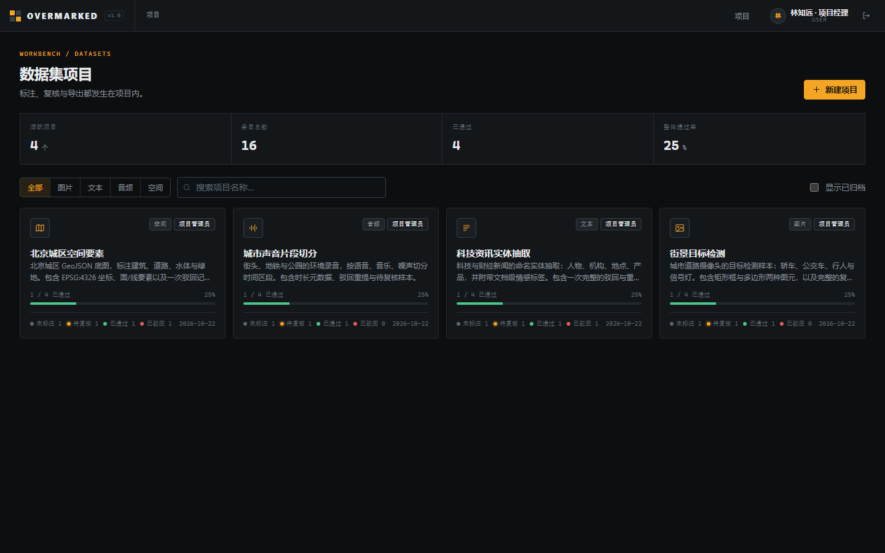

# OVERMARKED

多模态数据标注工作台 —— 面向**图片 / 文本 / 音频 / 空间**四类数据集的本地优先标注工具。

Node.js + SQLite + 本地文件存储，**零第三方依赖**（仅使用 Node.js 内置模块），自带登录、角色权限与审计。



> 截图取自本仓库自带的演示数据（`npm run seed:demo`），非设计稿。

---

## 目录

- [功能特性](#功能特性)
- [环境要求](#环境要求)
- [快速开始](#快速开始)
- [默认账号](#默认账号)
- [演示数据](#演示数据)
- [角色与权限](#角色与权限)
- [环境变量](#环境变量)
- [目录结构](#目录结构)
- [数据与备份](#数据与备份)
- [API 摘要](#api-摘要)
- [测试](#测试)
- [设计文档](#设计文档)

---

## 功能特性

**四类标注器**

| 数据类型 | 标注内容 | 内置标签体系 | 截图 |
|---|---|---|---|
| 图片 | 矩形框、多边形 | 轿车、公交车、行人、信号灯 | [查看](docs/screenshots/image-workbench.png) |
| 文本 | 实体（NER）、文档级标签 | 人物、机构、地点、产品；正向 / 中立 / 负向 | [查看](docs/screenshots/text-workbench.png) |
| 音频 | 时间区间分段 | 语音、音乐、噪声 | [查看](docs/screenshots/audio-workbench.png) |
| 空间 | GeoJSON 点 / 线 / 面 | 建筑、道路、水体、绿地 | [查看](docs/screenshots/spatial-workbench.png) |

**工程能力**

- **账号体系**：`scrypt` 密码散列、HttpOnly 会话 Cookie、CSRF 请求头校验、登录失败限流。
- **RBAC 权限**：系统角色（管理员 / 普通用户）+ 项目角色（管理员 / 质检员 / 标注员），按「查看 / 标注 / 复核 / 管理」四类能力细粒度授权。
- **状态机**：条目 `待办 → 进行中 → 待复核 → 已通过 / 已驳回`，标注在提交与复核时生成版本快照，全量历史可回溯。
- **导出**：图片 `COCO JSON`、文本 `NER JSONL`、音频 `JSONL`、空间 `GeoJSON`，可选择「仅已通过」或「全部标注」。
- **审计日志**：记录登录、权限变更、数据修改、复核与导出，可按操作类型与操作者过滤。
- **零依赖前端**：原生 HTML / CSS / ES Module，无需构建步骤，无 `node_modules`。

---

## 环境要求

- **Node.js >= 22.6.0**（依赖内置的 `node:sqlite`；测试脚本使用 `node --test` 的 glob 匹配，需 22.6.0 以上）
- 现代浏览器（Chrome / Edge / Firefox / Safari 最近版本）；跑浏览器端 E2E 需要 Chrome 或 Edge

无需 `npm install` —— 项目没有第三方依赖。

---

## 快速开始

```bash
# 1. 启动服务
npm start

# 2. 浏览器打开
#    http://127.0.0.1:8787
```

首次启动会自动：

1. 创建 `data/overmarked.db`（SQLite，WAL 模式，已开启外键约束）；
2. 创建系统管理员账号 `admin`，随机初始密码写入 `data/initial-admin.txt`；
3. 建立 `data/uploads/` 目录用于存放原始文件。

> **首次登录请立即修改密码**：登录后点击右上角头像 → 修改密码。`data/initial-admin.txt` 属于敏感文件，已在 `.gitignore` 中排除。

开发模式（文件变更自动重启）：

```bash
npm run dev
```

---

## 默认账号

| 账号 | 系统角色 | 说明 |
|---|---|---|
| `admin` | 系统管理员 | 用户管理、全局审计日志；初始密码见 `data/initial-admin.txt` |
| `demo_manager` | 普通用户 | 项目管理员：建项目、管成员、改标签体系、导出 |
| `demo_reviewer` | 普通用户 | 质检员：复核已提交条目 |
| `demo_annotator` | 普通用户 | 标注员：保存草稿、提交标注 |

后三个演示账号由 `npm run seed:demo` 创建，密码统一为 `DemoPass123!`（可用 `DEMO_PASSWORD` 覆盖）。

---

## 演示数据

```bash
npm run seed:demo
```

脚本会生成**完全离线**的演示数据，不下载任何外部资源：

- 4 个项目 × 4 个条目 = 16 个条目（图片 / 文本 / 音频 / 空间各一）；
- PNG 图片由内置 PNG 编码器现场绘制（CRC32 + zlib，无第三方库）；
- WAV 音频为 22.05 kHz 单声道 PCM，由内置写入器生成；
- 空间数据为 GeoJSON FeatureCollection；
- 文本为 4 篇中文语料，内嵌实体标注；
- 状态覆盖：`待办 4 / 进行中 2 / 待复核 4 / 已通过 4 / 已驳回 2`，并生成复核记录与标注版本。

脚本是**幂等**的：同名项目已存在时跳过；单个项目中途失败会整体回滚，不会留下半成品。

---

## 角色与权限

**系统角色**（决定能否进入管理控制台）

| 角色 | 能力 |
|---|---|
| 管理员 | 全部系统能力：用户增删改、停用/启用、全局审计 |
| 普通用户 | 只能访问被授予项目角色的项目 |

**项目角色**

| 项目角色 | 查看 | 标注 | 复核 | 管理 |
|---|:--:|:--:|:--:|:--:|
| 项目管理员 | ✓ | ✓ | ✓ | ✓ |
| 质检员 | ✓ | — | ✓ | — |
| 标注员 | ✓ | ✓ | — | — |

能力可在服务端集中校验（`server/acl.js`），前端隐藏按钮只是辅助，不作为安全边界。

---

## 环境变量

| 变量 | 默认值 | 说明 |
|---|---|---|
| `PORT` | `8787` | 监听端口（1–65535） |
| `HOST` | `127.0.0.1` | 监听地址。设为 `0.0.0.0` 可对外提供服务 |
| `DATA_DIR` | `<项目根>/data` | 数据目录（数据库 + 上传文件） |
| `SESSION_DAYS` | `7` | 会话有效期（天，1–365） |
| `UPLOAD_MAX_MB` | `512` | 单文件上传上限（MB，1–4096） |
| `TEXT_MAX_MB` | `10` | 文本文件上限（MB，1–256） |
| `ADMIN_USERNAME` | `admin` | 初始系统管理员用户名 |
| `ADMIN_PASSWORD` | 空 | 初始系统管理员密码；设置后不再生成随机密码 |
| `COOKIE_SECURE` | `0` | 设为 `1` 时 Cookie 仅通过 HTTPS 发送 |
| `TRUST_PROXY` | `0` | 设为 `1` 时信任 `X-Forwarded-*`（仅在反代后启用） |
| `DEMO_PASSWORD` | `DemoPass123!` | 演示账号密码（仅 `seed:demo` 使用） |

示例（Linux / macOS）：

```bash
PORT=8080 HOST=0.0.0.0 DATA_DIR=/srv/overmarked ADMIN_PASSWORD='强密码' npm start
```

> 对外提供服务时，务必使用 HTTPS 并设置 `COOKIE_SECURE=1`；`TRUST_PROXY=1` 只应在确认反向代理会正确清洗 `X-Forwarded-*` 头时开启。

---

## 目录结构

```
OVERMARKED/
├── server/                  # 后端（Node.js 内置模块，零依赖）
│   ├── index.js             # 启动入口
│   ├── app.js               # 应用装配：路由、静态资源、生命周期
│   ├── router.js            # 极简路由器
│   ├── http.js              # 请求解析 / 响应封装 / CSRF 校验
│   ├── db.js                # SQLite 连接、迁移、事务封装
│   ├── auth.js              # 密码散列、会话、限流
│   ├── acl.js               # RBAC 能力判定
│   ├── validation.js        # 标注数据校验（几何 / 区间 / 偏移）
│   ├── media.js             # 图片尺寸、WAV 时长识别
│   ├── storage.js           # 本地文件存储
│   ├── audit.js             # 审计日志
│   └── routes/              # auth / users / projects / items / annotations / export
├── public/                  # 前端（原生 ES Module，无需构建）
│   ├── index.html
│   ├── app.css
│   └── js/
│       ├── app.js           # 哈希路由、启动引导
│       ├── api.js           # API 客户端
│       ├── ui.js            # 通用组件（弹窗、提示、空状态、图标）
│       ├── views/           # 登录 / 项目列表 / 工作台 / 管理台 / 设置
│       └── annotators/      # image / text / audio / spatial 四类标注器
├── scripts/seed-demo.js     # 演示数据生成器
├── test/
│   ├── api.test.js          # 接口集成测试（node:test）
│   ├── e2e.browser.test.js  # 浏览器端 E2E（Chrome DevTools Protocol）
│   └── helpers/cdp.js       # 零依赖 CDP 驱动（真实鼠标 / 键盘事件）
├── docs/                    # 概要设计 / 详细设计 / 接口规范
└── data/                    # 运行时数据（数据库、上传文件、初始密码）—— 不纳入版本库
```

---

## 数据与备份

所有运行数据都在 `DATA_DIR` 下：

```
data/
├── overmarked.db        # SQLite 数据库（-wal / -shm 为 WAL 附属文件）
├── uploads/<uuid>/      # 原始文件，按条目 UUID 分目录
└── initial-admin.txt    # 初始管理员密码（首次启动后请删除）
```

**备份**：停止服务后整目录复制即可。运行中备份需一并复制 `overmarked.db-wal`。

**恢复**：还原目录后启动服务。

**迁移**：设置 `DATA_DIR` 指向新位置，或直接移动目录并保持权限。

---

## API 摘要

完整规范见 [`docs/03-接口规范.md`](docs/03-接口规范.md)。

| 方法 | 路径 | 说明 |
|---|---|---|
| `GET` | `/api/health` | 健康检查 |
| `POST` | `/api/auth/login` | 登录 |
| `POST` | `/api/auth/logout` | 登出 |
| `GET` | `/api/auth/me` | 当前登录用户 |
| `POST` | `/api/auth/password` | 修改密码 |
| `GET` | `/api/directory` | 用户目录（用于指派） |
| `GET` `POST` `PATCH` | `/api/users` | 用户管理（管理员） |
| `GET` `POST` | `/api/projects` | 项目列表 / 创建 |
| `GET` `PATCH` `DELETE` | `/api/projects/:id` | 项目详情 / 更新 / 删除 |
| `GET` `POST` | `/api/projects/:id/members` | 项目成员 |
| `PATCH` `DELETE` | `/api/projects/:id/members/:userId` | 成员角色变更 / 移除 |
| `GET` | `/api/projects/:id/stats` | 项目统计 |
| `GET` `POST` | `/api/projects/:id/items` | 条目列表 / 上传 |
| `GET` `PATCH` `DELETE` | `/api/items/:id` | 条目详情 / 更新 / 删除 |
| `GET` | `/api/items/:id/file` | 原始文件 |
| `PUT` | `/api/items/:id/annotation` | 保存 / 提交标注 |
| `POST` | `/api/items/:id/review` | 复核（通过 / 驳回） |
| `GET` | `/api/items/:id/history` | 标注版本历史 |
| `GET` | `/api/projects/:id/export` | 导出数据集 |
| `GET` | `/api/admin/audit` | 全局审计日志 |

**错误码约定**

| HTTP | `code` | 含义 |
|---|---|---|
| `400` | `BAD_REQUEST` | 请求格式错误 |
| `401` | `UNAUTHENTICATED` / `INVALID_CREDENTIALS` | 未登录 / 凭据错误 |
| `403` | `FORBIDDEN` | 权限不足 |
| `404` | `NOT_FOUND` | 资源不存在 |
| `409` | `INVALID_STATE` / `ITEM_APPROVED` / `PROJECT_ARCHIVED` | 状态冲突 |
| `413` | `PAYLOAD_TOO_LARGE` | 请求体超限 |
| `415` | `UNSUPPORTED_MEDIA_TYPE` | 文件类型不支持 |
| `422` | `VALIDATION_ERROR` | 字段或标注数据校验失败 |

所有写操作要求携带 `X-OM-Request: 1` 头作为 CSRF 防护。

---

## 测试

```bash
npm test          # 接口集成测试 + 浏览器端 E2E
npm run test:api  # 仅接口集成测试
npm run test:e2e  # 仅浏览器端 E2E（需要 Chrome / Edge）
```

当前 **20 项全部通过**（11 项接口集成 + 9 项浏览器端 E2E）。

### 接口集成测试（`test/api.test.js`）

基于 `node:test`，跑在真实 HTTP 服务与临时 SQLite 数据目录之上，不使用 Mock。覆盖：

- 静态页面与健康检查
- 认证、CSRF、未登录访问控制
- 用户 / 成员 / 项目角色的权限边界
- 图片：上传 → 尺寸识别 → 标注 → 提交 → 驳回 → COCO 导出
- 标签体系：新增标签、引用中的标签不可删除
- 文本：重叠校验、NER 导出、文件类型限制
- 音频：时长补丁、区段校验、JSONL 导出
- 空间：GeoJSON 元数据、坐标校验、GeoJSON 导出
- 归档只读、项目删除与文件清理
- 停用账号吊销会话并禁止登录
- 审计日志的操作 / 操作者过滤

### 浏览器端 E2E（`test/e2e.browser.test.js`）

通过 **Chrome DevTools Protocol** 驱动无头 Chrome，**零第三方依赖**（不使用 Playwright / Puppeteer）。驱动层 `test/helpers/cdp.js` 派发真实的 `mousePressed` / `mouseMoved` / `mouseReleased` 与键盘事件，走的是与人工操作完全相同的代码路径。

覆盖：

- 登录页错误密码提示 → 正确登录进入项目列表
- 图片：拖拽画框 → 保存草稿 → 提交复核 → 服务端状态与图元数量核对
- 质检员复核通过 → 条目状态流转
- 导出 COCO 与源标注框坐标一致
- 文本：拖选文本并打标 → 实体入库
- 音频：波形上拖拽分段 → 区段长度与边界校验
- 空间：点要素工具落点 → 几何类型与坐标校验
- 权限边界：标注员读用户列表 → 403；管理控制台无入口
- 全流程无 JS 异常、无控制台错误

> 浏览器缺席（未安装 Chrome / Edge）时该套件整体跳过，接口测试不受影响。

---

## 设计文档

| 文档 | 内容 |
|---|---|
| [`docs/01-概要设计.md`](docs/01-概要设计.md) | 目标、范围、总体架构、技术选型、数据模型、部署形态 |
| [`docs/02-详细设计.md`](docs/02-详细设计.md) | 模块划分、数据库表结构、状态机、标注器算法、权限矩阵、异常处理 |
| [`docs/03-接口规范.md`](docs/03-接口规范.md) | 全部接口的请求 / 响应 / 错误码 |

---

## 安全说明

- 密码使用 `scrypt`（随机盐）散列存储，不落库明文。
- 会话令牌通过 `HttpOnly` + `SameSite=Strict` Cookie 下发，数据库中仅存哈希。
- 所有状态变更接口校验 `X-OM-Request: 1`，配合 `SameSite=Strict` 抵御 CSRF。
- 登录接口按用户名 + IP 限流，抑制暴力破解。
- 服务端对每条路由独立鉴权，前端可见性控制不作为安全边界。
- 上传文件按条目 UUID 隔离存储，路径不直接由用户输入拼接。

部署到公网前请自行补充：HTTPS 终止、备份策略、访问审计与账号回收流程。

---

## License

MIT
